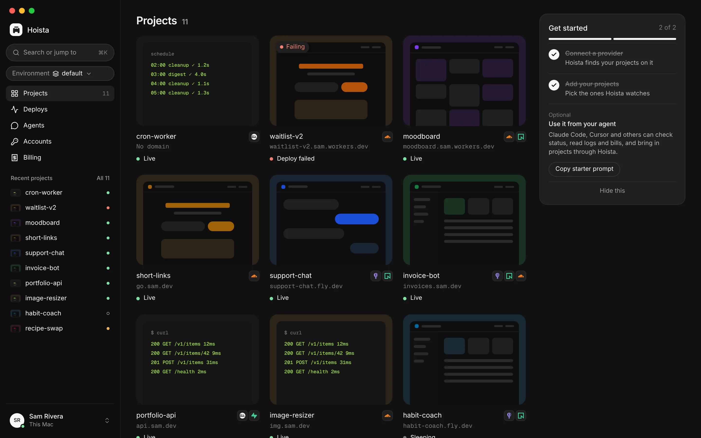

<p align="center">
  
</p>

<p align="center"><strong>Open-source control plane between your AI agents and your infrastructure.</strong></p>

<p align="center">
  <a href="https://github.com/TheDhejavu/hoista/actions/workflows/rust.yml"></a>
  <a href="https://github.com/TheDhejavu/hoista/releases"></a>
  <a href="LICENSE"></a>
</p>

<p align="center">
  <a href="https://hoista.dev">Website</a> ·
  <a href="https://docs.hoista.dev">Docs</a> ·
  <a href="https://docs.hoista.dev/getting-started/quickstart">Quickstart</a> ·
  <a href="https://docs.hoista.dev/cli/overview">CLI reference</a> ·
  <a href="https://docs.hoista.dev/security/overview">Security</a>
</p>

<p align="center">
  
</p>

Most projects end up spread across providers: the frontend on Vercel, the API on Railway or Fly.io, Postgres on Neon, a Worker on Cloudflare, email through Resend. Each has its own dashboard, CLI, logs and bill, and each coding agent you use wants its own API token for each of them.

Hoista connects to those accounts (Cloudflare, Fly.io, Railway, Vercel, Neon, Supabase, Render, Resend, Runpod, Modal and GitHub) and gives you one view of everything running on them. From the desktop app, the `hoist` CLI or any MCP-capable agent you can deploy, read logs and metrics, set variables, add domains, roll back and see what each provider billed.

It's not a host. Your apps keep running on your providers, and nothing sits between them and your users. Hoista keeps your tokens in the system keychain and runs on your computer, or on a server of yours if you want it reachable while your laptop is closed.

## Install

Hoista is in public beta. The current release is **0.1.0 Beta 2** (`v0.1.0-beta.3`): [download it](https://github.com/TheDhejavu/hoista/releases/tag/v0.1.0-beta.3) and read [what's in it](CHANGELOG.md).

The desktop app (macOS and Linux) and the CLI are on that release page. For the CLI on macOS or Linux:

```sh
curl -fsSL https://hoista.dev/install.sh | sh -s -- v0.1.0-beta.3
```

The installer verifies the release signature with [cosign](https://docs.sigstore.dev/cosign/system_config/installation/), puts `hoist` and `hoistd` in `~/.local/bin`, and starts Hoista at login. Windows and other options: [Install](https://docs.hoista.dev/getting-started/install).

## Quick start

Connect a provider with a token, bring in what already runs there, then look around:

```sh
hoist accounts add railway
hoist import
hoist status my-app
hoist logs my-app -f
```

From a project's folder, `hoist deploy` deploys it.

Run a command without its arguments and it asks for them. In scripts, pass everything and add `--json`. All commands: [CLI reference](https://docs.hoista.dev/cli/overview).

## With coding agents

Hoista is an MCP server. Add it to Claude Code or Codex and install the skills:

```sh
claude mcp add --scope user hoista -- hoist mcp
hoist skills install
```

For Codex, the first line is `codex mcp add hoista -- hoist mcp`.

`hoist mcp config` prints the JSON for other tools. ChatGPT and other web agents connect over HTTP through a tunnel you run to `127.0.0.1:8788`, and sign in with OAuth.

The agent gets tools, not tokens. When it first connects, it shows a code that you match in Hoista, and you choose what it may do: View only, Ask for approval or Full access, optionally limited to some environments and projects. Every call it makes is recorded.

The [skills](skills/README.md) are what make an agent good at this. The `hoista` skill is the entry point: it tells the agent what Hoista is, to check its access before planning, which skill handles the request (setup, deploy, fix or manage), and the rules every call follows. Ask "deploy this" and the agent plans it, deploys, waits for the build, checks the logs and gives you the URL.

## Security

- Provider tokens live in the system keychain (Keychain on macOS, Credential Manager on Windows, Secret Service on Linux), or in 1Password by reference. Hoista checks each token with its provider before saving it. `hoist accounts rotate` replaces one.
- Agents never see provider tokens. Each gets its own credential, at the access you chose.
- With Ask for approval, anything that can't be undone (deleting, removing a domain, connecting an account) waits for you to confirm with Touch ID or your password. Deleting also needs the name typed, and saves a copy of each database first.
- Secret values only go one way: into the provider. Hoista never prints one back, and strips them from what agents read.
- Nothing on your computer is opened to the network. The engine listens on a local socket, and on `127.0.0.1:8788` for MCP over HTTP (`hoist mcp http off` turns that off). A remote Hoista is owned with a passkey, and each computer signed in to it gets its own key.

Details: [Security overview](https://docs.hoista.dev/security/overview), [Threat model and limits](https://docs.hoista.dev/security/limits).

## What it does

- [Import](https://docs.hoista.dev/guides/import-apps) what already runs on your providers, grouped into projects. Watch a project as it is, or let Hoista manage it.
- [Deploy](https://docs.hoista.dev/guides/deploy) a folder: Hoista plans where each part runs, shows you the plan, and follows the deploy until it's live. Roll back to any earlier deploy.
- [Logs](https://docs.hoista.dev/guides/logs), metrics and daily usage, as each provider reports them.
- [Variables and domains](https://docs.hoista.dev/guides/environment): set values hidden or from a `.env` file, add custom domains, check their DNS.
- [Environments](https://docs.hoista.dev/guides/environments) such as production and staging, each with its own projects and agent rules.
- [Billing](https://docs.hoista.dev/guides/billing): what each provider has billed this period, and plan limits. Hoista never estimates cost.
- [Agents](https://docs.hoista.dev/agents/connect) over MCP, with [per-agent access](https://docs.hoista.dev/agents/permissions) and a record of every call.
- [Remotes](https://docs.hoista.dev/guides/remote): run Hoista on Railway, Fly.io or Docker and move your projects there in one step.
- [Backups](https://docs.hoista.dev/guides/backups) of Hoista's own state, an encrypted export for moving to another computer, and [webhooks](https://docs.hoista.dev/guides/webhooks).

## How it works

```
┌─────────────┐    ┌───────────┐    ┌─────────────────────┐
│ Desktop app │    │ hoist CLI │    │ Coding agents (MCP) │
└──────┬──────┘    └─────┬─────┘    └──────────┬──────────┘
       │ local socket    │ local socket        │ hoist mcp (stdio), or
       │                 │                     │ 127.0.0.1:8788 (HTTP)
       └─────────────────┼─────────────────────┘
                         ▼
          ┌─────────────────────────────┐
          │      hoistd, the engine     │
          │                             │
          │  access checks · approvals  │
          │  plans · deploys · journal  │
          └──────────────┬──────────────┘
                         │
        ┌────────────────┼──────────────────────┐
        ▼                ▼                      ▼
┌──────────────┐ ┌───────────────┐ ┌────────────────────────┐
│ OS keychain  │ │     SQLite    │ │ provider APIs and CLIs │
│ your tokens  │ │  in ~/.hoista │ │ Cloudflare · Fly.io ·  │
└──────────────┘ └───────────────┘ │  Railway · Vercel · …  │
                                   └────────────────────────┘
```

`hoistd` does the work; the app, the CLI and agents are clients of it. It talks to each provider through its API, or through the provider's own CLI where that's the supported path (wrangler, flyctl, the Railway CLI). Every change is written to a journal before it's sent, so retrying after a crash or a dropped connection never applies it twice. `hoist` starts the engine when a command needs it.

## Providers

| Provider   | What Hoista works with                                   |
| ---------- | -------------------------------------------------------- |
| Cloudflare | Workers, Pages, D1, KV, R2 and DNS                       |
| Fly.io     | Apps and Machines                                        |
| Railway    | Projects, services and databases                         |
| Vercel     | Projects, deployments and domains                        |
| Neon       | Serverless Postgres                                      |
| Supabase   | Postgres, auth and storage                               |
| Render     | Web services, workers, cron jobs, Postgres and Key Value |
| Resend     | Email sending domains                                    |
| Runpod     | GPU and CPU pods, Serverless endpoints and volumes       |
| Modal      | Serverless GPU apps and volumes                          |
| GitHub     | The repositories projects deploy from                    |

Per-provider detail: [Providers](https://docs.hoista.dev/providers/overview).

## Building from source

You need [Rust](https://rustup.rs) 1.97; rustup picks it up from `rust-toolchain.toml`.

```sh
git clone https://github.com/TheDhejavu/hoista.git
cd hoista
cargo build --release --locked -p hoist -p hoistd
./target/release/hoist --version
```

To install the CLI and the daemon, both into `~/.cargo/bin`:

```sh
cargo install --locked --path bin/hoist
cargo install --locked --path bin/hoistd
hoist doctor
```

Keep `hoist` and `hoistd` in the same folder: the CLI starts the daemon from there. `hoist service install` starts Hoista at login.

### Desktop app

The desktop app also needs Node.js 22. On Linux it needs the system webview's libraries: `libwebkit2gtk-4.1-dev`, `libayatana-appindicator3-dev` and `librsvg2-dev` on Debian and Ubuntu.

```sh
npm ci
npm run desktop:build
```

The app is in `apps/desktop/src-tauri/target/release/bundle/`. On Linux, ask for a package: `npm run desktop:build -- --bundles deb,appimage`. The app uses the daemon installed above.

## Contributing

Issues and pull requests are welcome. [CONTRIBUTING.md](CONTRIBUTING.md) covers running Hoista while you work on it, how the code is laid out, and the checks CI runs. Adding a provider starts at [docs/backend/adding-a-provider.md](docs/backend/adding-a-provider.md).

Report security problems privately through [GitHub security advisories](https://github.com/TheDhejavu/hoista/security/advisories/new), not in public issues.

## License

MIT. See [LICENSE](LICENSE).
