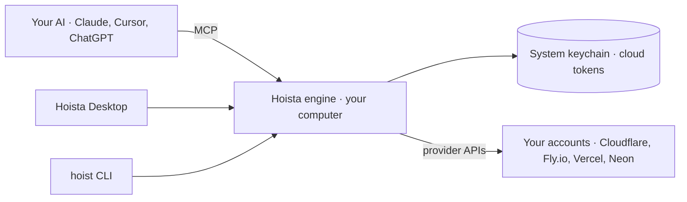

# Hoista

Deploy apps built with AI, from your own machine. Hoista runs on your computer and deploys to your own Cloudflare, Fly.io, Vercel and Neon accounts. There is no Hoista account and no Hoista server: cloud tokens stay in your system keychain and every provider call is made from your machine.

Any AI that speaks MCP (Claude, Cursor, Codex, ChatGPT and others) can deploy and manage your apps through Hoista. Hoista Desktop is the app for seeing what is live, what is failing and what it costs.

Hoista is early. The engine and the `hoist` command line are being built in the open; deploys, import, the MCP server and the desktop app are not available yet.

## Project at a glance



| Folder | Purpose |
| --- | --- |
| `crates/engine/` | The engine: providers, deploys and the app map |
| `bin/hoist/` | `hoist`, the command line |
| `apps/web/` | The hoista.ai website, plain HTML, CSS and JavaScript |
| `.github/` | Continuous integration |

## Run locally

Requires Rust 1.97 (pinned in `rust-toolchain.toml`).

```sh
cargo run -p hoist -- providers
cargo test --workspace
python3 -m http.server 8080 --directory apps/web
```

## Checks

CI runs the same commands:

```sh
cargo fmt --all -- --check
cargo clippy --workspace --all-targets --locked -- -D warnings
cargo test --workspace --locked
RUSTDOCFLAGS="-D warnings" cargo doc --workspace --no-deps --locked
```

## Licence

MIT. See [LICENSE](LICENSE).
